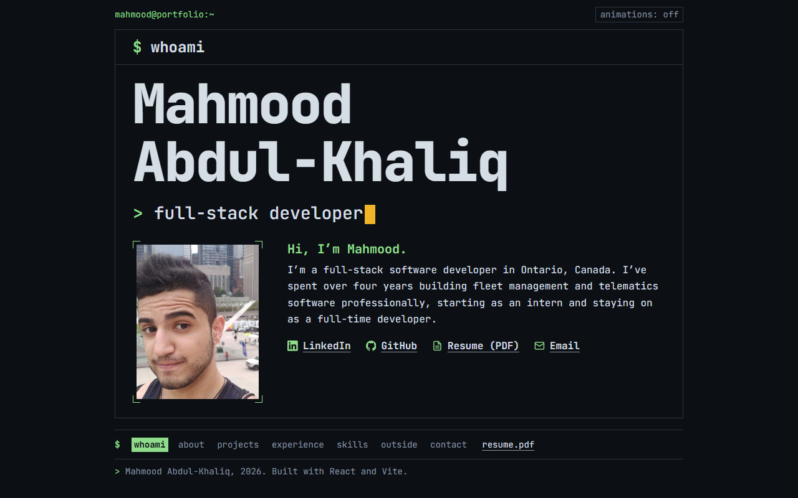

# Portfolio website

Personal portfolio site built with React and Vite.
Visit it publically at https://mahabdulkhaliq.github.io/.



## Run it

```
npm install
npm run dev
```

## Edit content

All text, links and projects live in `src/content/`, one file per section:

- `profile.js`: the name, the Home tab text and the About me text
- `links.js`: the link row on Home and the Contact tab
- `projects.js`, `experience.js` (jobs and skills), `education.js` and `interests.js`
- `footer.js`: the phrases the footer types

Photos go in `public/photos/` and project screenshots in `public/projects/`. The resume
is `public/resume.pdf`, built from `resume/resume.html` by running `resume\build.ps1`.

## Deploy

`npm run build` writes a static site to `dist/`. Any static host works:

- **Vercel or Netlify**: import the GitHub repo; build command `npm run build`, output `dist`.
- **GitHub Pages**: publish `dist/` with a Pages workflow. Asset paths are relative, so it
  works at `username.github.io/repo` without extra config.
